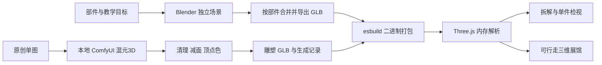

# 可复用的 Web 3D 展馆制作管线

本项目把可拆分工程结构交给 Blender 建模，把开放式艺术雕塑交给现有 ComfyUI / 混元3D，再由 Three.js 负责浏览器交互。两类资产各自保留来源和可编辑文件。

## 从资产到网页

## 本轮使用的技能

| 技能 | 用途 | 下个项目何时复用 |
| --- | --- | --- |
| create-3d-model | 路由建模、源文件、导出与视觉验收 | 交付可编辑、可移植三维资产时 |
| blender-pro-workflow | 先结构、材料细节，再导出与检视 | 多阶段或多资产统一制作时 |
| blender-modeling / blender-materials / blender-export | 网格、倒角、材质、GLB部件组织 | 可拆产品、硬件或机械原理模型 |
| three-product-lab | PBR展品、拆解、部件选择及说明联动 | 交互产品或博物馆展品 |
| systematic-debugging | 用实际状态与投影定位交互问题 | 拆解遮挡、异步切换与布局失败 |
| verification-before-completion | 资产、浏览器与逻辑验证 | 提交和打包前 |

这些能力来自本机现有技能和插件，本轮没有重复安装软件、下载额外模型或调用付费生成服务。运行网页不依赖这些开发工具。

## Blender 工程约定

脚本为 `tools/blender/build_exhibits.py`。本机 Blender 位于 `D:/blender/blender.exe`。MCP 连接的工程内使用 `COL-AI-Museum-Engineering` 独立场景，原场景保留。

- `GEO-match-assembly` 的键：`shell`、`cpu`、`gpu`、`memory`、`network`、`board`。
- `GEO-accelerator-assembly` 的键：`pcb`、`compute`、`vram`、`heatsink`、`fan`。
- 可选择根节点的自定义属性 `key` 导出为 glTF `extras.key`。网页据此关联说明，不依赖自动网格名称。
- 源文件保留固定件、导轨、鳍片、接口、走线、棋子等独立几何；临时导出副本按交互部件合并并保留多材质。
- 导出限定当前任务场景和选择对象，排除摄影机、灯光及默认立方体。移除临时副本后，源几何继续可编辑。

Three.js 世界采用 Y 向上。脚本以 `(x, y, z) → (x, -z, y)` 写入 Blender，再按 Y-up 导出。改变轴向要同时验证棋盘法线、风扇朝向与部件位置。

硬件使用金属、粗糙度和环境光形成层次，少量状态窗发光。它们不是具体品牌和历史实物复刻，没有制造精度保证。

### 重建与检查

新工程按脚本 `blockout`、`detail` 阶段顺序执行。已有源文件使用 QA 阶段检查，不在完成场景重复执行 detail。通过 MCP 用 `runpy.run_path` 传入 `PHASE`，阶段选择以脚本当前入口为准。调用保留用户原始建模请求，不能用内部计划冒充用户指令。

导出后检查根节点、key集合、mesh primitive、索引范围、三角面预算及外部资源依赖。网页另查多材质高亮、选择与真实尺寸。文件存在不代表交互正确。

## ComfyUI 雕塑管线

复用 `127.0.0.1:8188` 现有服务和 `hunyuan3d-dit-v2_fp16.safetensors` 模型。输入为本地制作的原创三叶环与核心参考图，交付几何来自实际推理。

权威执行图为 `tools/comfy/learning-core-attempt-1.api.json`，可查看节点图为 `learning-core.workflow.json`，seed `2026102307`。完整参数、输入指纹、history和后处理证据见 provenance 与输出目录。

原始网格经过体素表面清理、轻度平滑、减面与顶点着色。成品 Y-up、Z正面、底部中心原点，便于落在展台。颜色与材质由本地后处理产生，未运行纹理生成模型。

单图无法保证工程尺寸、内部结构或精确背面。需要机械配合、按钮或精确拆分时，应采用明确分件的 Blender 资产。本次生成结果仅用于艺术装置。

## 离线加载与生命周期

`build.mjs` 将 `.glb` 二进制嵌入 script.js，`engineering-models.mjs` 使用 `GLTFLoader.parseAsync` 解析 ArrayBuffer。没有运行时外部模型请求，可以直接打开 index.html；修改模型后必须重新构建。

`createMuseumScene` 复用一个 renderer。递增 generation 标记排除过期异步载入，并释放过期资源，避免快速切换时旧模型覆盖新模型。材质按网格克隆，避免共享材质一起高亮。

大厅只在打开时渲染，关闭取消 RAF 并恢复焦点，重复打开复用资源。大厅打开时暂停背景展品与神经网络。完整销毁时释放几何、材质、纹理、环境贴图、监听器和观察器。

## 无遮挡拆解布局

`exhibit-layout.mjs` 在装配状态记录部件的世界包围盒、中心和原位置。相机变化后，将包围盒投影到相机 right / up 两轴，得到该视角最大宽高。

每件预留35%边界与固定间隔，按行放入网格：宽画幅三列、窄画幅两列。中心位于相机目标平面，机架完全移出板卡。相机依总宽高、画幅比和视场角取景。验证实际包围盒八角投影的画幅内与两两不相交，不只检查编号。

部件从原位置平滑插值，旋转时持续重新分区，滚轮允许自主缩放。单件检视居中放大且隐藏其他部件；射线排除隐藏祖先，防止命中不可见结构。训练与自我对弈的旧连线、粒子在拆开时隐藏，恢复时回到装配位置。

## 角色、实验与自由参观

角色使用纯 reducer：先取证、再判断，成功后进入下一阶段。错误可修正，复盘保留尝试。三种身份互相独立，也不影响六关数值实验。所有情境是原创教学推演，不模拟真实人物原话。

行走使用固定视高和每帧小步移动，按轴检测外墙、六座展台和中央装置，允许沿边滑动。碰撞用于参观导航，不是物理仿真。目录、地图和键盘为不便拖动的使用者提供同样内容入口。

## 下个项目的最小清单

1. 确定部件和教学说明，约定稳定 key。
2. Blender 完成结构、尺度、材质，导出独立 GLB 与源文件。
3. 仅为合适艺术资产使用 ComfyUI，保留真实执行证据。
4. 先实现选择、展开、复位和生命周期，再加动画。
5. 用真实模型包围盒测试不同相机/画幅，普通点击检验网格与标记。
6. 检查离线启动、手机控件、退出焦点、重复进入和资源释放。
7. 运行数值和交互回归，重建离线产物，再提交 Git 和打包。
